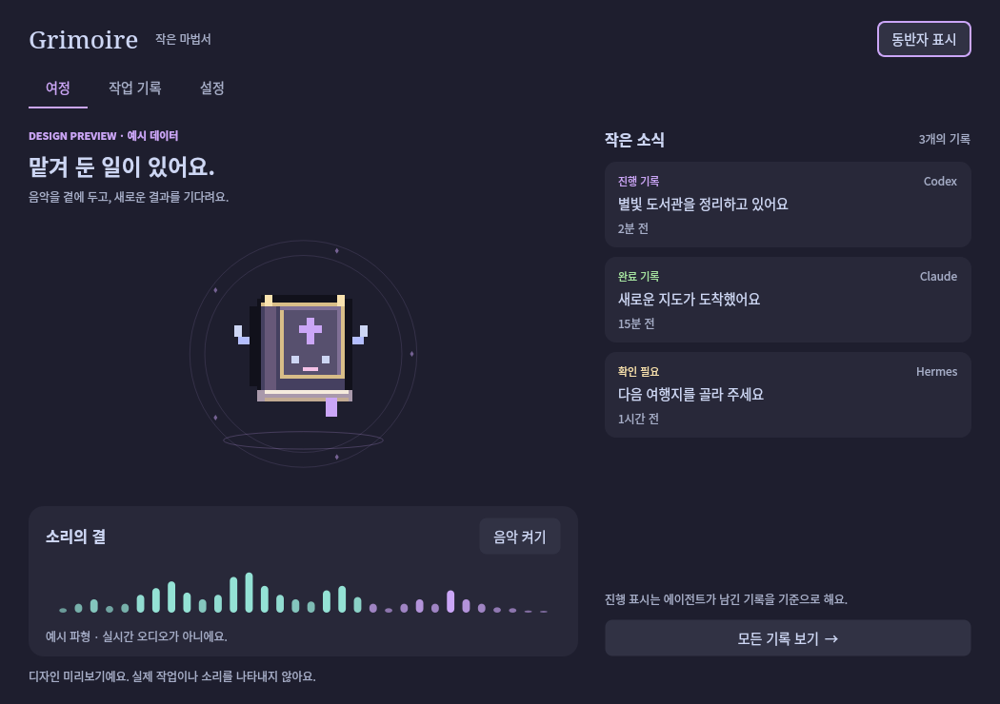

# Grimoire

Grimoire is a small Linux desktop companion for recorded agent work and system playback audio. It uses a native Qt interface, reads local task/event files, and does not require an account or network service.



This is beta software. KDE Plasma 6 on X11 with PipeWire is the verified target. Wayland placement and tray behavior depend on the compositor and remain unverified.

## Features

- A draggable desktop familiar reflects recorded work states and recent completions.
- CAVA can show system playback audio. It does not use the microphone; unavailable audio is shown as unavailable.
- The journal can open local result and handoff files with bounded, read-only handling for text documents.
- A read-only `agent-task` adapter and `grimoire event` CLI accept explicit task updates. The application does not claim tasks or execute commands from event data.
- Settings, logs, and optional data-only character packs stay in the user's XDG directories.

The task view reports the contents of records. A valid lease records ownership; it does not prove that a process is running.

## Install

Requires Python 3.11 or later, PySide6 Essentials, a Linux desktop session, and CAVA for audio visualization. PipeWire's PulseAudio compatibility service can provide the playback monitor.

```sh
python -m venv .venv
.venv/bin/pip install .
.venv/bin/grimoire
```

For a user-local launcher and application files, run `python tools/install.py`. It does not install system packages or enable login autostart. Remove those application files with `python tools/install.py --uninstall`; user settings and logs are retained.

## Use

In Settings, choose a directory containing `PROJECT/TASK/state.json` records, or use the generic event CLI:

```sh
grimoire event --id map --agent example --state working --title 'Drawing a map'
grimoire event --id map --agent example --state done --title 'Map ready' --artifact ./map.png
```

Refresh working events before their default 300-second time to live. Use `--handoff ./notes.md` to attach a continuation note. Artifact and handoff paths come from the local event or task records; records are read without changing them. The viewer applies supported file-type and size limits.

`grimoire --demo` opens a labeled synthetic preview. `grimoire doctor` reports available prerequisites.

## Character packs

The built-in book familiar and vector icon are original project artwork. Optional character packs use an image and JSON grid metadata; packs contain data, not executable code. No third-party character artwork is included. The MIT license applies to project code and original artwork only.

## Privacy and local files

- Settings: `$XDG_CONFIG_HOME/grimoire/settings.json` (default `~/.config`).
- Skins and application data: `$XDG_DATA_HOME/grimoire` (default `~/.local/share`).
- Events and logs: `$XDG_STATE_HOME/grimoire` (default `~/.local/state`).

Logs are bounded and avoid task titles and raw record bodies. The application does not scan transcripts or send telemetry.

## Development

See [Getting started](docs/START_HERE.md), [design notes](docs/STYLE_GUIDE.md), [development](docs/DEVELOPMENT.md), [record keeping](docs/RECORDING.md), and the [roadmap](docs/ROADMAP.md).

```sh
.venv/bin/pip install -e '.[dev]'
.venv/bin/pytest
.venv/bin/ruff check src tests tools
QT_QPA_PLATFORM=offscreen .venv/bin/grimoire --demo --capture /tmp/grimoire-preview.png
```

The last command writes only the selected capture path. `pytest` includes `tests/test_smoke.py`, which runs the event CLI, `doctor`, the offscreen demo capture and a start/quit cycle with temporary HOME and XDG directories. The Qt parts are skipped if Qt cannot load; the tray, companion placement and CAVA audio still need `tools/smoke_native.py` on a real desktop.

On a headless Linux server or CI runner (verified on Ubuntu 24.04), the offscreen Qt platform fails with `ImportError: libEGL.so.1` unless the Qt runtime libraries are installed:

```sh
sudo apt-get install -y --no-install-recommends libegl1 libgl1 libxkbcommon0 libfontconfig1 libdbus-1-3
```

Korean interface text in captures needs a CJK font such as `fonts-noto-cjk`. The application's control socket lives in `$XDG_STATE_HOME/grimoire/control.sock`; keep that path under about 100 characters, because Unix sockets cannot use longer paths and startup otherwise fails with "Could not open local application socket."

For license boundaries and external dependencies, see [THIRD_PARTY.md](THIRD_PARTY.md). Project code and original artwork use the MIT license.

CI configuration under `ci/` is a reference template for a standalone checkout. In this repository the same checks run from the root workflow `.github/workflows/public-programs-smoke.yml`.
